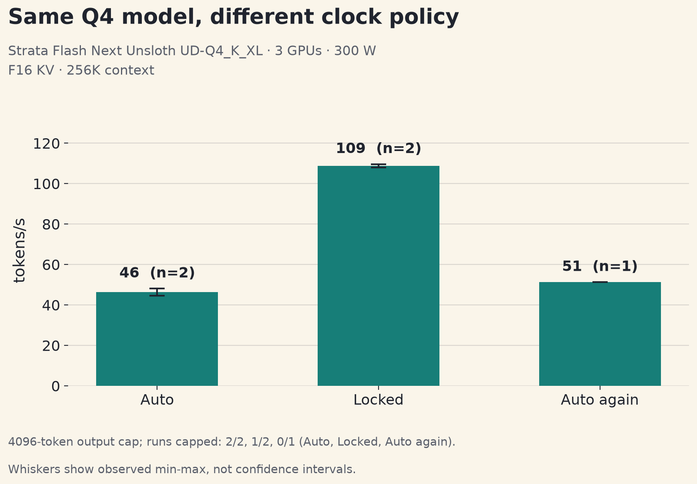
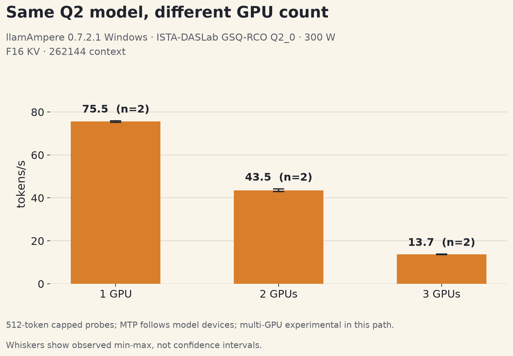
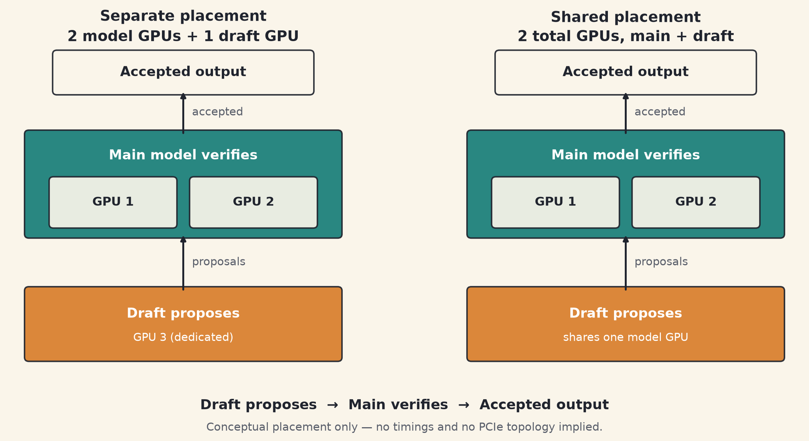

# My AI Model Ran Faster on One GPU Than Three

I tried to make Qwen faster. My computer had a few objections.

I have three RTX 3090 graphics cards. It seemed reasonable to expect that using all three would make an AI model faster.

Then one of my tests produced this:

**One GPU: 76 tokens per second. Three GPUs: 14.**

The same model. The same question. The same context capacity. Adding two graphics cards had made the answer arrive much more slowly.

A result like that makes a spreadsheet look suspicious.

In a separate test, a model went from **46 to 109 tokens per second** when I changed its GPU clock settings. I had kept the same model loaded throughout.

I started out comparing smaller model files. I ended up investigating clocks, memory, software, and whether the third GPU was earning its place in the computer.

Here is what those speed numbers actually mean.

## A few translations before the numbers

**Qwen** is a family of AI models that you can run on your own computer. I tested Qwen3.8-27B Dense and Qwen3.8 Flash Next. A **GPU** is the graphics card doing much of the calculation.

A model generates text in **tokens**: small pieces of text that can be words, parts of words, or punctuation. More tokens per second usually means less waiting while the answer appears. It says little about whether that answer deserves your trust.

The model's **weights** are the learned numbers it uses to produce an answer. The 27B in the dense model's name means roughly 27 billion learned parameters. **Quantization** stores those numbers with less precision, saving memory. Think of rounding a huge collection of numbers so they take less space. The actual methods are more careful than rounding everything in exactly the same way.

Labels such as **Q8, Q4, and Q2** describe roughly eight-, four-, and two-bit weight formats. Lower numbers generally mean smaller files, with a possible cost in accuracy. Files can mix precisions, so Q4 does not promise that every weight uses exactly four bits.

An **inference engine** is the program that runs the model. I used Strata, llama.cpp, and later llamAmpere, a version of llama.cpp tuned for NVIDIA's RTX 30-series cards. The model file and the program running it both matter.

## One computer and one coding question

My workstation has a Threadripper PRO 5955WX processor, 128 GB of system memory, and three RTX 3090s with 24 GB of GPU memory each.

The question was always:

> Write a C# implementation of an LRU cache. Explain the time complexity of each operation.

You do not need to know C# to follow the experiment. An LRU cache is a small storage area that throws out the item you have gone longest without using when it needs room. I asked the model to write one and explain its work.

That gives the model enough to generate a substantial response. It also puts a boundary around this study: I measured speed on one question. I did not systematically compile the answers or check whether the generated caches worked correctly.

| Setting | What it meant in this experiment |
|---|---|
| Power limit | 300 W per participating GPU |
| Requests | One at a time |
| Context capacity | Usually 256K; reduced after memory failures where stated |
| Warmup | One request excluded from the measured results |
| Repetitions | Usually two measured requests in the comparisons below |
| Generation limit | 8,192 tokens for full-answer tests; 512 for short probes; 4,096 for the clock experiment |

**Context capacity** is the room available for the current conversation, instructions, documents, and generated response. Here, K means 1,024 tokens.

A 256K capacity gives the model a large desk. My short coding question put very little paper on it. Reserving that desk space can still affect the memory budget, which becomes important later.

The model also keeps a **KV cache**, saved attention data from earlier tokens that it can reuse. Think of it as working notes. The **F16** format stores those notes as 16-bit floating-point values. That cache needs memory alongside the model weights.

The generation limit is a separate setting: an artificial stopping point. A 512-token probe ends early on purpose. It is useful for a quick speed check, although the model may still be thinking when it hits the limit.

The token counts include both generated reasoning and the visible answer. Speeds here are rounded to whole tokens/s. The [benchmark workbook](https://github.com/kokosda/medium/raw/refs/heads/main/20261123-qwen-rtx3090-benchmarks/Qwen3.8%20Benchmark.xlsx) keeps the original measurements and all 101 experiment records.

## The model file stayed the same and the speed doubled

The clock investigation involved Flash Next running in Strata with Unsloth's Q4 weights.

The full file label was **UD-Q4_K_XL**. That means an **Unsloth Dynamic four-bit recipe**: it gives different parts of the model different amounts of precision. The letters distinguish the recipe; they do not describe a bigger or smaller version of the model. [Unsloth explains its approach here](https://unsloth.ai/docs/basics/dynamic-3.0-ggufs).

I kept the model loaded on three GPUs and tested three phases:

1. Let the GPUs manage their clocks automatically.
2. Apply clock limits and measure again.
3. Remove those limits and return to automatic management.

A GPU's **clocks** control the operating speeds of its calculation cores and memory. Normally, the card adjusts them itself. In the middle phase, I constrained the core-clock range and memory clocks. That is what I mean by the **locked phase**.

The 300 W power limit stayed the same. Power limits and clock limits are different controls. Also, “locked” here means a constrained policy; the cores could still move within the permitted range.

*Same loaded model, three GPUs, 256K capacity, and a 4,096-token generation limit. The phases had two, two, and one measured requests, after excluding a warmup in each phase. The small black marks show the observed speed range.*

The result was **46 tokens/s, then 109, then 51**. The locked phase was more than twice as fast as the first automatic phase. Returning to automatic clocks brought the rate back toward the slower result.

That is a substantial change to hide behind the same filename.

The sample is small, and the answer lengths differed: two requests hit the limit in the first phase, one in the locked phase, and none in the last. I changed core and memory clock settings together, so this test cannot tell me which part of that change helped most.

The useful conclusion is that **clock state mattered to this configuration**. It gave me a reason to check how the hardware was operating before declaring a quantization format slow. The [saved clock readings and phase markers](https://github.com/kokosda/medium/tree/main/20261123-qwen-rtx3090-benchmarks/evidence/clock) are available with the data.

The later llamAmpere tests used automatic clocks.

## More GPUs gave the software more to coordinate

The GPU-count surprise came from Flash Next Q2 under llamAmpere.

This Q2 was produced by ISTA-DASLab. Its full label, **GSQ-RCO Q2_0**, identifies a two-bit-class recipe that assigns different precisions across the model. The publisher reports an average of about **2.4 bits per transformer weight**. The [model card](https://huggingface.co/ISTA-DASLab/Qwen3.8-Flash-Next-GSQ-RCO-GGUF) explains how it chooses what to compress.

I ran two measured requests each on one, two, and three GPUs. Every request stopped at 512 generated tokens. All used 256K capacity, the same attention-cache format, and 300 W power limits.

*llamAmpere v0.7.2.1, Windows CUDA12 build 15466, commit 857ccba7d. The multi-GPU cases split model layers across cards. The helper that guesses upcoming tokens used the same GPU devices as the main model. Two measured requests per case, warmup excluded.*

The result went from **76 tokens/s on one GPU to 44 on two and 14 on three**. One card was about five and a half times as fast as all three in this probe.

The extra cards had made an excellent case for taking the afternoon off.

Flash Next is a **mixture-of-experts model**. It has specialist groups of weights called experts, and it selects which ones to use for each token. The engine has to make the right weights available at the right time.

Spreading work across separate cards gives the software more movement and coordination to manage. In this tested version, the project's [Flash Next launcher](https://github.com/JakeATX/llamAmpere/blob/v0.7.2.1/scripts/flash-next-server.sh) defaults to one GPU and describes the multi-GPU path as experimental. It also warns about slow behavior when there is too little spare system memory.

That makes the result less mysterious. It still does not tell me how much time went into moving data, waiting for it, or doing calculations. I did not measure those costs separately.

This is a finding about **this recipe, software build, Windows setup, and workload**. A separate full-answer test on one GPU averaged **74 tokens/s** across two requests, close to its short-probe result.

## I gave the third GPU a different job

Another way to use the spare card was to let it help guess the next tokens.

**MTP**, short for multi-token prediction, supplies draft guesses that the main model checks. When enough guesses are useful, the main model can check several at once and save work. Unhelpful guesses cost drafting time without earning it back.

It is a little like asking a colleague to draft the next paragraph while you review the current one. It helps only if the draft is useful and the handoff is cheap enough. In the actual system, these are token proposals and model verification steps.

*The drawing shows who proposes tokens and who checks them. It does not show measured transfer speeds or the machine's physical wiring.*

I compared two ways of running the dense model. **Dense** means it uses the same core network for each token, rather than choosing from a set of experts.

Both cases used ggml-org's Q4 weights. The full label was **Q4_K_M**: a mostly four-bit recipe that gives some weight arrays more precision. M identifies its medium variant. The [quantizer's rules](https://github.com/ggml-org/llama.cpp/blob/master/src/llama-quant.cpp) explain the details.

| Vendor | Quantization | GPUs | Generation tokens/s |
|---|---|---|---:|
| ggml-org | Q4 | 2 GPUs, draft shared | 48 |
| ggml-org | Q4 | 2 model GPUs + 1 MTP GPU | 46 |

The main model stayed on CUDA1 and CUDA2 in both cases. Sharing put the draft on CUDA1; the dedicated setup moved it to CUDA0. Both used 256K capacity, the same attention-cache format, the same Q8 draft file, and the same draft depth. Each case had two measured requests, and all four responses ended normally.

The dedicated third card made the overall result slightly slower. Using the original measurements before rounding, sharing was about 5% faster.

My third GPU had received a specialist title. The speed had declined anyway.

Finding out exactly why would require measurements of the handoff and checking work inside the engine.

## A smaller model file can buy you a larger desk

Memory created a different tradeoff in the dense tests.

The model weights share memory with the KV cache and other work. The controlled comparisons used the same F16 cache format. A smaller weight file leaves more room for everything else; reducing context capacity can also help a configuration fit.

Here are six full-answer cases. Each had one excluded warmup, two measured requests, automatic clocks, and 300 W power limits. Every measured response ended before the 8,192-token limit.

| Vendor | Quantization | GPUs | Context | Generation tokens/s |
|---|---|---|---:|---:|
| Unsloth | Q2 | 1 GPU, draft shared | 128K | 83 |
| Unsloth | Q3 | 1 GPU, draft shared | 128K | 80 |
| Unsloth | Q5 | 1 GPU, draft shared | 32K | 71 |
| ggml-org | Q4 | 1 GPU, draft shared | 64K | 76 |
| ggml-org | Q4 | 2 GPUs, draft shared | 256K | 48 |
| ggml-org | Q4 | 2 model GPUs + 1 MTP GPU | 256K | 46 |

The Unsloth entries are its dynamic two-, three-, and five-bit-class recipes. The ggml-org Q4 entries use the medium four-bit recipe described above. Exact filenames are recorded in the workbook.

The one-GPU Q4 case reached **76 tokens/s**, compared with **48** on two GPUs. There is a catch big enough to deserve its own column: the one-GPU case had only **64K context capacity**. Its attempts at 256K and 128K failed with out-of-memory errors.

If you need 256K available, the faster 64K setup cannot do that job. If your work fits 64K, its speed is worth considering. Context capacity is part of the product you are choosing.

For reference, the ggml-org Q8 dense baseline managed **47 tokens/s** at 256K with two model GPUs and a dedicated draft GPU. That is close to the Q4 result with the same arrangement. Smaller weights did not automatically make that deployment faster.

## The 105 token result came with extra changes

One dense configuration reached **105 tokens/s** on a single GPU at 256K capacity. Both measured responses ended normally.

That looks like an easy winner until you read the settings.

It used jakeatx's **Swift1.5 Uncensored**, a version with adjusted model weights, and **AI4**, a custom four-bit-class weight format. It also used built-in adaptive drafting and **SJ-KVaRN4** cache compression.

SJ-KVaRN4 sounds like a password the GPU refuses to remember. Its job is straightforward to describe: **compress the saved attention data so it takes less memory**.

The older cache entries use a roughly four-bit representation, with extra bookkeeping and different storage for the first and most recent tokens. That means the whole cache is not exactly a quarter of the size of F16. Compression loses some numerical detail and can affect the output. The [cache-format documentation](https://github.com/JakeATX/llamAmpere/blob/v0.7.2.1/docs/KV-cache-quantization.md#hybrid-sj-kvarn44-with-tq6-staging) explains the layout.

The weights and the cache are two different things being compressed. This run changed both, along with the model variant and drafting setup. I did not isolate each change, so I cannot award all 105 tokens/s to one clever format.

It is a promising configuration to investigate, including for answer quality.

## The ten fastest recorded configurations at the largest context

I sorted the 300 W-per-card records by **context capacity first, then generation speed**, both from highest to lowest. Every selected case has two measured requests. I used the later Flash Next Q8 control instead of its earlier duplicate baseline.

All ten rows land at 256K because capacity takes priority in this ordering. The table uses short quantization labels. **IQ4** is the compact nonlinear four-bit Unsloth variant named **UD-IQ4_XS**; nonlinear means its stored number levels are unevenly spaced. AI4 keeps its custom-format name. The other Q4 entries here use Unsloth's dynamic recipe.

| Rank | Context | Generation tokens/s | Prefill tokens/s | Model | Quantization | Vendor | GPUs |
|---:|---:|---:|---:|---|---|---|---|
| 1 | 256K | **121** | 60 | Flash Next | Q4 | Unsloth | 2 GPUs, draft shared |
| 2 | 256K | **118** | 115 | Flash Next | IQ4 | Unsloth | 3 GPUs, draft shared |
| 3 | 256K | **109** | 60 | Flash Next | Q4 | Unsloth | 3 GPUs, draft shared |
| 4 | 256K | **105** | 656 | Dense Swift | AI4 | jakeatx | 1 GPU, built-in MTP |
| 5 | 256K | **99** | 701 | Dense Swift | AI4 | jakeatx | 1 GPU, built-in MTP |
| 6 | 256K | **95** | 704 | Dense Swift | AI4 | jakeatx | 2 GPUs, draft shared |
| 7 | 256K | **92** | 44 | Flash Next | Q8 | Unsloth | 3 GPUs, draft shared |
| 8 | 256K | **85** | 38† | Dense | Q4 | Unsloth | 2 model GPUs + 1 MTP GPU |
| 9 | 256K | **83** | 118 | Flash Next | Q4 | Unsloth | 1 GPU, draft shared |
| 10 | 256K | **81** | 32† | Dense | Q2 | Unsloth | 2 model GPUs + 1 MTP GPU |

**Prefill** is the stage where the engine reads the prompt before generating its response. Generation speed describes how quickly the response tokens follow. Both columns are averages over the same two measured requests.

For Strata's prefill number, I used the initial prompt-reading log entry and excluded later internal prompt passes. The llama.cpp and llamAmpere values come from the API's prompt-processing rate. [The saved prefill data](https://github.com/kokosda/medium/blob/main/20261123-qwen-rtx3090-benchmarks/prefill-results.json) contains the individual measurements.

**† Rows 8 and 10 reused 67 of the 71 prompt tokens**, leaving only four new tokens to process. The other rows processed all 71. These are short-prompt rates. They cannot tell you how quickly the same setup would read a 256K-token document.

The ranking mixes complete responses, short probes, and clock experiments. “Dense Swift” uses the adjusted Swift1.5 Uncensored weights and SJ-KVaRN4 cache; the other entries use F16. The two-GPU AI4 probe also overlapped a restricted background download.

| Rank | Engine | Clocks | Generation limit | What happened |
|---:|---|---|---:|---|
| 1 | Strata | Automatic | 4,096 | One response finished; one hit the limit |
| 2 | Strata | Locked | 8,192 | Both responses finished |
| 3 | Strata | Locked | 4,096 | One response finished; one hit the limit |
| 4 | llamAmpere | Automatic | 8,192 | Both responses finished |
| 5 | llamAmpere | Automatic | 512 | Both short probes hit the limit |
| 6 | llamAmpere | Automatic | 512 | Both short probes hit the limit |
| 7 | Strata | Automatic | 8,192 | Both responses finished |
| 8 | llama.cpp | Automatic | 8,192 | Both responses finished |
| 9 | Strata | Automatic | 4,096 | Both hit the limit |
| 10 | llama.cpp | Automatic | 8,192 | Both hit the limit during reasoning |

Row 10 never reached the visible C# answer within its budget. Its rate is real, but the task was still unfinished. A model can think quickly for quite a while without handing you any usable code.

The [ranking data](https://github.com/kokosda/medium/blob/main/20261123-qwen-rtx3090-benchmarks/top-10-results.csv) preserves original values, record IDs, and sources. Ranking uses those values before rounding. This table shows the fastest recorded rates under differing conditions; the smaller comparisons above are where I held more settings constant.

## Some tests ended with a timeout

Flash Next's native AI3 and AI4 paths—custom three- and four-bit-class weight formats—did not produce completed speed measurements in the controlled one-to-three-GPU probes. Several requests reached the 240-second deadline.

Those rows stay in the workbook as failures or timeouts. A missing measurement gets a missing value. Writing zero would pretend I had measured something I had not.

The logs reported problems making expert data available to the GPU. The [tested version's source](https://github.com/JakeATX/llamAmpere/blob/v0.7.2.1/src/llama-moe-arena.cpp) disables its full pinned-memory arena on Windows: a system-memory arrangement intended to keep data ready for GPU access. Another [fallback memory-mapping path](https://github.com/JakeATX/llamAmpere/blob/v0.7.2.1/src/llama-model-loader.cpp) is Linux-only.

That is a software and platform boundary worth recording. It does not establish how newer builds or a Linux setup would perform.

## Enough setup detail to repeat the question

The [article folder](https://github.com/kokosda/medium/tree/main/20261123-qwen-rtx3090-benchmarks) contains the workbook, exact presets, request example, chart data, and plotting source. Here is part of the recorded dense Q4 setup:

    device = CUDA1,CUDA2
    ctx-size = 262144
    parallel = 1
    cache-type-k = f16
    cache-type-v = f16
    spec-draft-device = CUDA0

Those lines put the main model on two cards, reserve 256K capacity, allow one request at a time, use F16 attention storage, and put the draft on the third card. The exact token count appears in the setting because the server needs its numeric value.

This is an excerpt from the [complete preset](https://github.com/kokosda/medium/blob/main/20261123-qwen-rtx3090-benchmarks/dense-q4-2plus1.ini). It also needs the model files and remaining settings. The original installed llama.cpp router was launched with:

    llama serve --models-preset "D:\LLM\Models\models.ini" --host 127.0.0.1 --port 8080

That command chooses a preset file. The later llamAmpere results require the specific tested llamAmpere build, rather than assuming the installed command points to it. The [request example](https://github.com/kokosda/medium/blob/main/20261123-qwen-rtx3090-benchmarks/request-example.ps1) sends the same coding question to an already-running server. It is separate from the full timing collector.

For readers checking the details: sampling used temperature 0 and seed 42. I averaged generation rates after excluding warmup, using Strata's engine logs and the other engines' API timings. These exclude prompt-reading time. Time to first token was measured separately.

The controlled dense llamAmpere cases used the same Q8 draft file at depth 3. Flash Next used the vendor Q2 draft with adaptive depth 3–4, with expert skipping off. Both set the draft probability threshold to 0. Draft depth is how many tokens the draft tries ahead; adaptive depth changes that number while running.

The build's default **mode-biased MTP** stayed enabled. That changes which draft guesses are accepted and can change the output compared with exact sampling. The [drafting documentation](https://github.com/JakeATX/llamAmpere/blob/v0.7.2.1/docs/speculative.md) describes the setting. A fixed seed alone does not make all these configurations produce identical answers.

## What I would choose first

My first decision would be the amount of context the job needs. Then I would choose a configuration that fits it, run a supported software path, and measure that workload.

Only then would I start celebrating a faster number.

The extra GPUs might help fit the model. A smaller quant might free enough memory to use fewer cards. A drafting helper might save time, or spend it. The clock settings might change the result while the model file sits there looking innocent.

My next test would add more prompts and check the generated code. That would give the speed numbers something useful to stand next to: evidence that the answers are worth waiting for.
