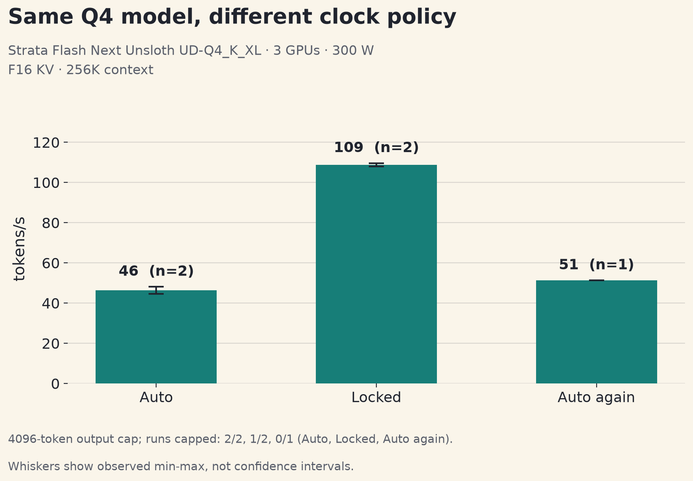
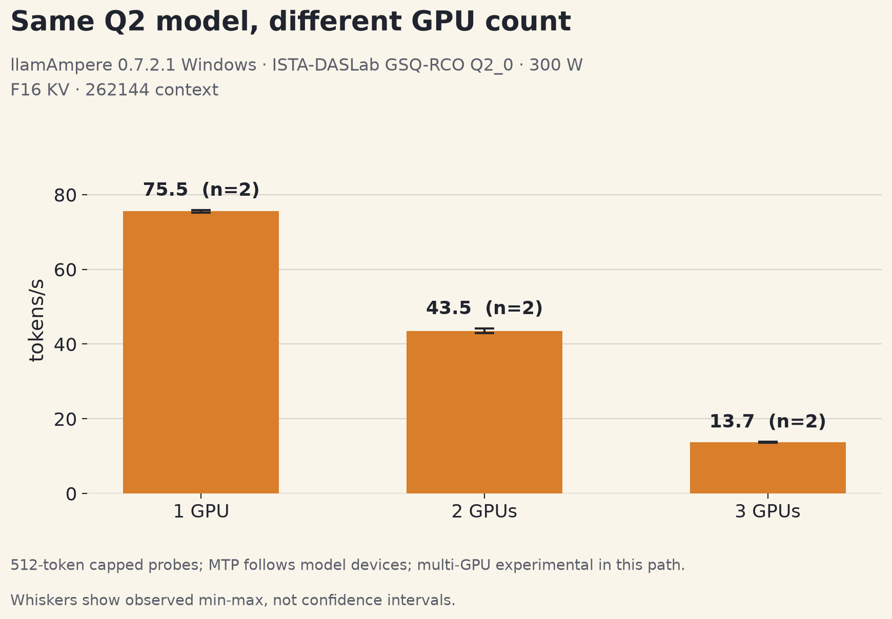
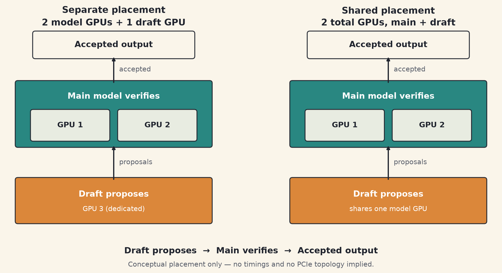

# Why the Same Qwen Quant Ran at 46 and 109 Tokens per Second

Three RTX 3090s, one C# prompt, and a benchmark that kept turning into a configuration investigation.


I started with a straightforward question: how much generation speed would I gain by moving below Q8?

Then the same Q4 model produced **46.35 tokens per second in one configuration and 108.75 in another**. Returning to automatic clocks brought it back to 51.29.

The weights had not changed. The quant label had not changed. The clock policy had.

That result changed the question. Before comparing smaller models, I needed to understand what the machine was actually doing with them.

Quantization stores model weights at reduced numerical precision. That can make a model easier to fit in memory. The speed you get still depends on how the inference engine executes it, where the data lives, and what the hardware is doing.

I tested Qwen3.8-27B Dense and Flash Next under Strata and llama.cpp, then repeated selected workloads with llamAmpere. Some configurations finished comfortably. Others ran slower with more GPUs. Several never produced a completed measurement.

This article focuses on the Strata clock diagnostic and the later llamAmpere comparisons that taught me the most. The [benchmark workbook](https://github.com/kokosda/medium/raw/refs/heads/main/20261123-qwen-rtx3090-benchmarks/Qwen3.8%20Benchmark.xlsx) contains the wider record: 101 experiment records, including exploratory runs and failed attempts. It is a record of configurations, not 101 interchangeable samples.

## One machine and one deliberately ordinary prompt

The workstation has a Threadripper PRO 5955WX, 128 GB of RAM, and three RTX 3090s with 24 GB each. For the controlled tests discussed here, the GPU power limit was 300 W per card.

The prompt was always:

> Write a C# implementation of an LRU cache. Explain the time complexity of each operation.

It asks for code and an explanation, which makes it useful for observing sustained generation. It also gives this study a clear boundary: I measured one coding task, not a representative collection of workloads.

An LRU cache combines a lookup structure with an ordering structure. I did **not** systematically compile the generated C#, test its eviction behavior, or score the explanations. A faster answer in these tables is not evidence of a better implementation.

Here are the conditions readers need before looking at the numbers.

| Setting | How I used it |
|---|---|
| Requests | One at a time |
| Sampling | Temperature 0, seed 42 |
| Target context capacity | 262,144 tokens |
| KV cache | F16 (16-bit floating point) for the controlled comparisons |
| Warmup | One excluded request per case |
| Repetitions | Actual measured count shown for each comparison |
| Full-answer output limit | 8,192 generated tokens |
| Short scaling probes | 512 generated tokens |
| Clock diagnostic output limit | 4,096 generated tokens |

The **KV cache**, short for key-value cache, stores intermediate attention data from earlier tokens so the model can reuse it as the conversation grows. **F16** stores those values as 16-bit floating-point numbers. The cache has its own memory budget and storage format, separate from the model weights.

Context capacity and output limit are different settings. A 262,144-token context does not mean that this short prompt filled 262,144 tokens. It sets the capacity available to the server, and that allocation can affect which configurations fit in memory.

The output limit is an artificial ceiling on generation. A 512-token probe deliberately stops early; it is not a completed LRU explanation. The generated-token count includes reasoning as well as the visible answer.

For llamAmpere, I used the server's `timings.predicted_per_second` and averaged completed measured requests after excluding warmup. The older Strata clock experiment used its engine-log aggregate. Both describe decoding, but I keep the two engines in separate comparisons. Neither number is the total end-to-end request rate including prompt processing.

**MTP means multi-token prediction.** A draft component proposes upcoming tokens, and the main model checks them. Draft depth is how many tokens it tries ahead in a round; adaptive depth changes that number while running. The controlled dense llamAmpere cases used the same external Q8 MTP file at depth 3. Flash Next used the vendor Q2 draft with adaptive depth 3–4, with expert skipping off. Both set the draft probability threshold (`p-min`) to 0.

The build's default **mode-biased MTP** also remained enabled. This changes the draft-acceptance policy and can change the output compared with exact sampling. It is another reason these are configuration-speed results, with answer quality still to be evaluated. [The pinned speculative-decoding documentation](https://github.com/JakeATX/llamAmpere/blob/v0.7.2.1/docs/speculative.md) describes these settings.

## The clock experiment that changed the investigation

The first useful surprise came from Flash Next with Unsloth's `UD-Q4_K_XL` weights under Strata. The model stayed loaded across three GPUs, with the same 300 W limit, F16 KV cache, and 262,144-token context capacity.

I changed clock policy, measured, then returned to automatic clocks.



*Whiskers show the observed minimum and maximum, not confidence intervals. Each phase excluded one warmup. All phases used a 4,096-token output ceiling; completion lengths differed.*

| Clock policy | Mean tokens/s | Observed range | Measured runs | Runs reaching output limit |
|---|---:|---:|---:|---:|
| Automatic | 46.35 | 44.60–48.10 | 2 | 2 of 2 |
| Locked | 108.75 | 107.89–109.61 | 2 | 1 of 2 |
| Automatic again | 51.29 | 51.29 | 1 | 0 of 1 |

The locked phase was about **2.35 times** as fast as the first automatic phase. Returning to automatic clocks moved the rate back toward the original slower state.

That is useful evidence that clock state mattered in this configuration. It does not identify how much came from memory clocks, core clocks, power-state transitions, or their interaction. I did not independently vary each of those factors.

It is also a small experiment. The return phase has one measured request, and the generated responses were not identical lengths. Treat it as a strong diagnostic observation rather than a universal speed multiplier.

The practical lesson is easy to miss when a quant name is the largest label in a spreadsheet: check the operating state before blaming the weights. A Q4 result can include the cost of a particular clock policy, placement strategy, and execution path.

The [clock telemetry and phase markers](https://github.com/kokosda/medium/tree/main/20261123-qwen-rtx3090-benchmarks/evidence/clock) are included with the article data.

The later llamAmpere results below used automatic clocks. I did not carry the clock lock into those comparisons.

## Three GPUs made this Flash Next probe slower

Next came a result that looks backward if you expect every additional GPU to help.

I ran the same Flash Next ISTA-DASLab `GSQ-RCO Q2_0` quant on one, two, and three GPUs. These were short, deliberately capped 512-token probes, all with F16 KV, 262,144-token context capacity, and two measured requests after warmup.



*llamAmpere v0.7.2.1, Windows CUDA12 build 15466, commit 857ccba7d. Multi-GPU runs used layer splitting; the MTP draft followed the model devices. Every measured probe reached its 512-token ceiling.*

| GPUs | Mean tokens/s | Measured runs |
|---|---:|---:|
| 1 GPU with MTP shared | 75.53 | 2 |
| 2 GPUs with MTP following model devices | 43.54 | 2 |
| 3 GPUs with MTP following model devices | 13.72 | 2 |

The one-GPU configuration was about 5.5 times as fast as the three-GPU configuration in this probe.

That does not establish that Flash Next generally scales backward. It tells me that this quant, placement, workload, and pinned Windows build did.

There is a useful clue in the project's own [Flash Next launcher at v0.7.2.1](https://github.com/JakeATX/llamAmpere/blob/v0.7.2.1/scripts/flash-next-server.sh). It defaults to one GPU and describes the device-side expert-table path as single-GPU, with multi-GPU operation experimental. It also warns about very slow behavior when host-memory headroom is insufficient.

Those restrictions matter for a **mixture-of-experts model**: it routes each token to a selection of specialist parameter blocks called experts. A dense model uses the same core network for each token. The execution path has to make the relevant expert weights available as tokens are generated. Adding devices can change how that work is placed and moved, rather than simply dividing identical work into equal pieces.

My measurements do not isolate transfer time or prove that paging caused the three-GPU slowdown. The source explains why a simple GPU-count expectation is unsafe here; it is not a profiler trace of these requests.

A separate full-answer run of this Q2 configuration on one GPU averaged **73.96 tokens/s**, with two measured responses. That is reassuringly close to its short-probe rate, but it remains a separate measurement with an 8,192-token ceiling.

## A draft GPU still has to earn its place

I also tried a different use for the third card: leave the main dense model on two GPUs and dedicate the third to MTP.

MTP supplies draft token proposals that the main model verifies. A separate draft device changes where that work happens; it does not remove verification or guarantee an overall speedup.



*Conceptual placement diagram. Arrows show proposals and verification, not measured transfer rates or the workstation's PCIe topology.*

The cleanest full-answer comparison here used ggml-org's dense `Q4_K_M`, the same external Q8 MTP file, the same F16 KV format, and the same 262,144-token context capacity.

| Vendor | Quant | GPU arrangement | Mean tokens/s | Measured runs |
|---|---|---|---:|---:|
| ggml-org | Q4_K_M | 2 GPUs with MTP shared | 48.03 | 2 |
| ggml-org | Q4_K_M | 2 model GPUs + 1 MTP GPU | 45.58 | 2 |

The main model stayed on CUDA1 and CUDA2. In the shared case, MTP used CUDA1; in the dedicated case, it used CUDA0.

Both configurations completed naturally, averaging 7,460 generated tokens per request. Sharing MTP on the two cards was about 5.4% faster in this comparison.

I can measure the total effect of that placement choice. I cannot assign the difference to communication overhead, draft scheduling, or verification cost without further profiling. The dedicated draft GPU was a hypothesis worth testing, and this pair did not reward it.

## Smaller dense quants changed what fit

The dense model produced a more familiar tradeoff: lower quants could fit on one card, but preserving the full context capacity was not always possible.

The table below contains six full-answer configurations from the resumed tests. Each excluded one warmup, measured two requests, and stopped naturally before the 8,192-token ceiling. Power limits were 300 W and clocks were automatic.

| Vendor | Dense quant | GPUs | Context capacity | Mean tokens/s | Measured runs |
|---|---|---|---:|---:|---:|
| Unsloth | UD-Q2_K_XL | 1 GPU, MTP shared | 131,072 | 83.16 | 2 |
| Unsloth | UD-Q3_K_XL | 1 GPU, MTP shared | 131,072 | 79.64 | 2 |
| Unsloth | UD-Q5_K_XL | 1 GPU, MTP shared | 32,768 | 71.13 | 2 |
| ggml-org | Q4_K_M | 1 GPU, MTP shared | 65,536 | 76.41 | 2 |
| ggml-org | Q4_K_M | 2 GPUs, MTP shared | 262,144 | 48.03 | 2 |
| ggml-org | Q4_K_M | 2 model GPUs + 1 MTP GPU | 262,144 | 45.58 | 2 |

This is where an attractive leaderboard would mislead me.

The 76.41-token/s one-GPU Q4 run used a quarter of the context capacity of the 48.03-token/s two-GPU run. The one-GPU Q4 attempts at 262,144 and 131,072 failed with out-of-memory errors before I reduced the capacity to 65,536.

If you need 262,144 tokens available, the faster 65,536-token configuration does not meet your requirement. If your workload fits the smaller capacity, its speed is relevant. The useful choice depends on the constraint you actually have.

The same care applies to quant labels. `UD-Q4_K_XL` and `Q4_K_M` identify different quantization variants. A shared “Q4” prefix does not make them identical weight files or interchangeable benchmark subjects.

For reference, my dense ggml-org Q8 full-answer baseline at 262,144 context with two model GPUs plus a dedicated MTP GPU averaged **46.65 tokens/s** across two measured requests. That is close to the Q4 dedicated-draft result above. Reducing the nominal bit width did not automatically improve that particular deployment.

## The fastest dense number had different conditions

There was also a **105.17-token/s** full-answer result on one GPU at 262,144 context.

It came from jakeatx's native AI4 dense preset, using the **Swift1.5 Uncensored** variant, its built-in adaptive MTP, and **SJ-KVaRN4** KV storage. Two measured requests completed naturally.

**SJ-KVaRN4 is a compression scheme for the attention cache.** AI4 is llamAmpere's custom four-bit format for model weights; SJ-KVaRN4 describes how the stored attention data is represented. The “4” refers to the four-bit representation used for the older, compressed cache entries, compared with the 16-bit values in F16.

That does not make the entire cache exactly four times smaller. The format includes metadata and uses different storage for the initial tokens and the recent-token window. The conversion is lossy, so it can also affect the model's output. [The pinned cache-format documentation](https://github.com/JakeATX/llamAmpere/blob/v0.7.2.1/docs/KV-cache-quantization.md#hybrid-sj-kvarn44-with-tq6-staging) explains the layout.

For this benchmark, the consequence is practical: cache compression changes the memory footprint and the attention computation alongside the weight format. I did not isolate its contribution, so I cannot attribute the 105.17-token/s result to SJ-KVaRN4 alone.

That is an interesting configuration result. It changes the fine-tuned weights, quant format, KV format, and drafting setup at once. Putting it at the top of an original-weights Q8-to-Q2 chart would conceal exactly the conditions that might explain its performance.

It belongs in the workbook and deserves its own follow-up comparison, including answer quality. It cannot settle which quant of the original dense model is best.

## Failed attempts belong in the record

The native Flash AI3 and AI4 paths did not give me completed controlled throughput measurements in the one-to-three-GPU probes. Several requests reached the 240-second deadline.

I kept those attempts as failures or timeouts. Assigning them zero tokens/s would imply a completed measurement that never happened.

Logs showed mapped-registration failures, a 1 GiB staging cap, and missing device expert tables in relevant attempts. The pinned source gives those messages useful context: [`pin_supported()` returns false on Windows](https://github.com/JakeATX/llamAmpere/blob/v0.7.2.1/src/llama-moe-arena.cpp), and the full pinned-arena constructor also rejects Windows. A [private writable fallback remap](https://github.com/JakeATX/llamAmpere/blob/v0.7.2.1/src/llama-model-loader.cpp) is guarded for Linux.

Those are limitations of the version and path I tested. They do not prove that the model family is unusable on Windows or that a later build behaves the same way.

## Reproduce the question before comparing the answer

The full measurement archive contains request JSON, streamed output, server logs, summaries, and GPU telemetry. The [public article folder](https://github.com/kokosda/medium/tree/main/20261123-qwen-rtx3090-benchmarks) includes the workbook, the data behind the figures, and the figure-rendering source.

My launch pattern started by setting the power limit on each participating card:

```powershell
$watts = 300
$gpuIds = @(0, 1, 2)

foreach ($gpuId in $gpuIds) {
    nvidia-smi -i $gpuId -pl $watts
}

nvidia-smi --query-gpu=index,name,power.limit,power.draw --format=csv
```

My original installed llama.cpp router launch looked like this:

```powershell
llama serve --models-preset "D:\LLM\Models\models.ini" --host 127.0.0.1 --port 8080
```

The later tables use the pinned llamAmpere binary identified above. To reproduce those results, select that build explicitly and use the recorded preset; the installed `llama` command alone does not identify an engine build.

For example, these settings from the recorded dense Q4 dedicated-draft preset put the main model on CUDA1 and CUDA2 and drafting on CUDA0:

```ini
device = CUDA1,CUDA2
split-mode = tensor
tensor-split = 1,1
ctx-size = 262144
parallel = 1
cache-type-k = f16
cache-type-v = f16
fit = off
spec-type = draft-mtp
spec-draft-model = D:/LLM/Models/mtp-Qwen3.8-27B-Q8_0.gguf
spec-draft-device = CUDA0
spec-draft-n-max = 3
spec-draft-p-min = 0.0
```

The [complete recorded preset](https://github.com/kokosda/medium/blob/main/20261123-qwen-rtx3090-benchmarks/dense-q4-2plus1.ini) also specifies the main model file, full GPU offload, and Flash Attention. Its paths are specific to this workstation.

The preset matters as much as the launch command. Record the actual devices, split mode, context capacity, KV format, fit behavior, MTP file, and MTP device placement. A model name in a request does not tell you those settings.

For a small request example, the repository includes [request-example.ps1](https://github.com/kokosda/medium/blob/main/20261123-qwen-rtx3090-benchmarks/request-example.ps1). It sends the same prompt with temperature 0, seed 42, and an 8,192-token output ceiling, and streams the response. It is a request example; the timing collector used for the study additionally saved telemetry and checked completion status.

Before calling a result comparable, check that it shares the workload and the conditions you are trying to hold constant. Save a warmup separately. Record whether generation stopped naturally or hit its ceiling. Keep time to first token separate from sustained decoding. Report the actual repetition count.

Most of all, decide what the machine has to support before chasing its highest number.

On this workstation, fitting the required context, choosing a supported execution path, placing MTP, and checking clock state all changed the result enough to matter. My next benchmark would start with those constraints fixed, then compare quants on several prompts and test the generated code. That would answer the question a tokens-per-second chart alone leaves open: which configuration is fast enough **and** produces work worth keeping?
